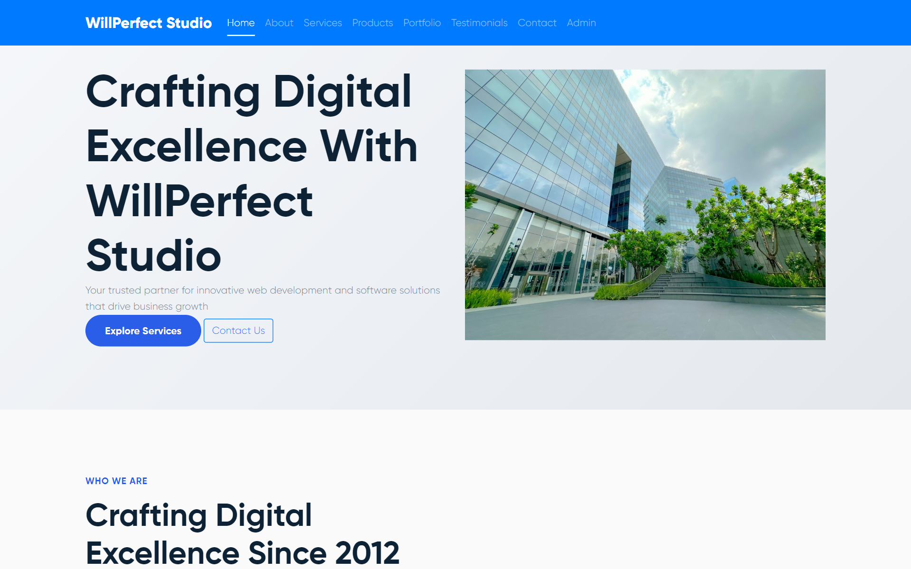
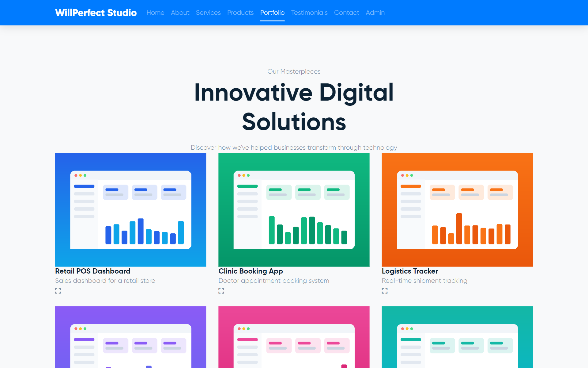
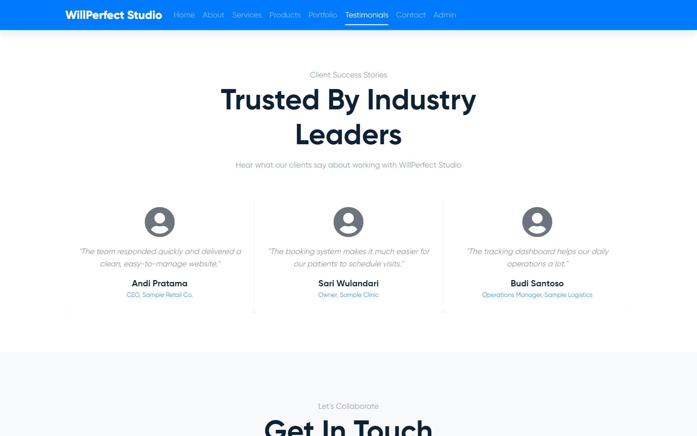
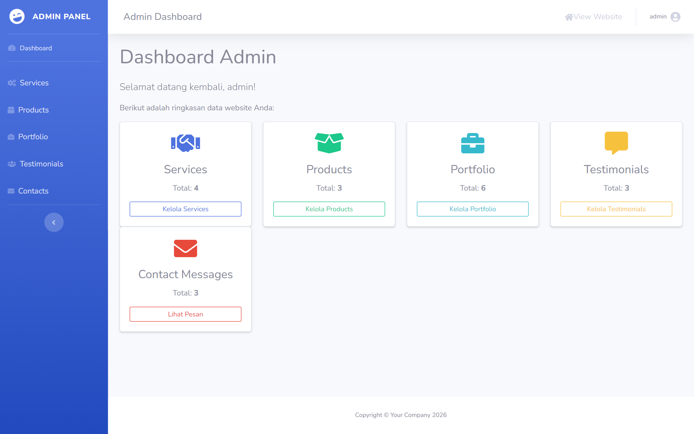
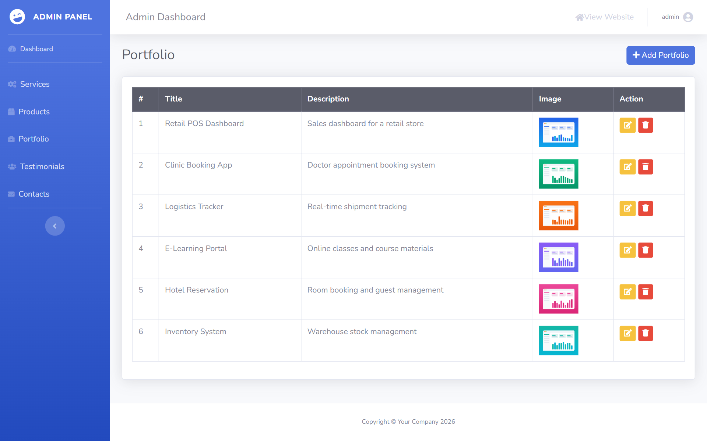
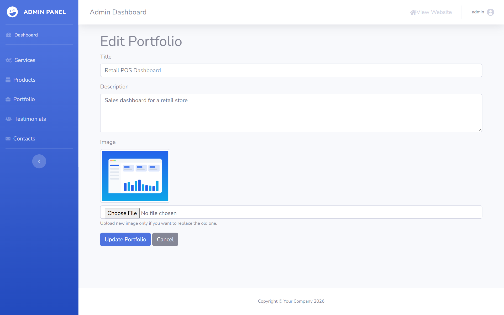
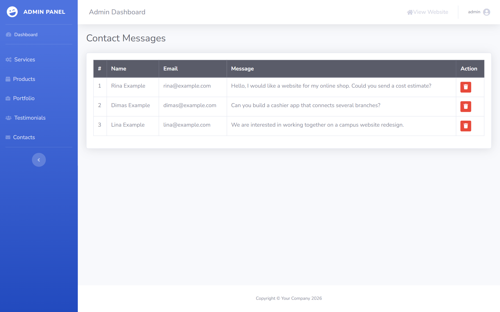

# 🌐 WillPerfect Studio – Company Profile Website

[](https://github.com/willyrafaelfs/Tugas-UAS-Pemrograman-Web-Company-Profile)
[](https://codeigniter.com)
[](https://themeforest.net)

Website Company Profile ini merupakan proyek tugas UAS dari mata kuliah *Pemrograman Web*, dikembangkan menggunakan **CodeIgniter 4**. Website ini dibuat untuk **WillPerfect Studio**, studio pengembangan software fiktif. Halaman depan berupa satu halaman (Home, About, Services, Products, Portfolio, Testimonials, Contact) yang dibangun di atas template HTML5 **Onova** dari ThemeForest / Envato Elements. Admin Panel berbasis **SB Admin 2** dipakai untuk mengelola **services**, **products**, **portfolio**, **testimonials**, dan pesan dari **contact form**.

**Live demo (pratinjau statis):** https://willyrafaelfs.github.io/Tugas-UAS-Pemrograman-Web-Company-Profile/

> Live demo hanya berisi halaman depan dengan konten contoh. Admin Panel dan form kontak hanya berfungsi jika aplikasi dijalankan secara lokal (lihat bagian *Clone & Setup* atau *Menjalankan dengan Docker* di bawah).

---

## 📸 Tampilan



| Portfolio | Testimonials |
|---|---|
|  |  |

| Dashboard Admin | Kelola Portfolio |
|---|---|
|  |  |

| Edit Portfolio | Pesan Kontak |
|---|---|
|  |  |

*Semua nama, email, dan konten pada screenshot adalah data fiktif dari `DemoContentSeeder`.*

---

## 📌 Fitur Utama

### 🔹 Frontend
- Satu halaman dengan navigasi scroll: Home, About, Services, Products, Portfolio, Testimonials, Contact
- Bagian Products, Portfolio, dan Testimonials diambil dari database; Services dan About masih berupa konten statis
- Form kontak dengan validasi server, pesan tersimpan ke database
- Desain profesional dan responsif

### 🔹 Admin Panel
- CRUD untuk: Services, Products, Portfolio, Testimonials
- Upload gambar portfolio dengan validasi tipe dan ukuran (maks. 2 MB), nama file acak, dan penghapusan file lama saat gambar diganti atau data dihapus
- Dashboard berisi jumlah data per modul
- Manajemen pesan dari contact form

### 🔹 Keamanan
- Filter autentikasi di semua route `/admin`
- Proteksi CSRF global
- Hapus data lewat POST (bukan GET) dengan konfirmasi
- Validasi input di sisi server
- Password admin disimpan dalam bentuk hash (`password_hash` / `password_verify`)

### 🔹 Deploy & Pengembangan
- **Docker Compose** (PHP 8.2 + Apache dan MySQL 8.4): migrasi berjalan otomatis setelah database siap
- **Pratinjau statis otomatis**: GitHub Actions (MySQL) dan GitLab CI (SQLite) menjalankan migrasi dan seeder konten contoh, merender halaman depan, lalu `scripts/build-pages.php` menghapus link admin dan mengganti form kontak dengan pemberitahuan sebelum dipublikasikan ke GitHub Pages dan GitLab Pages
- **Seeder konten contoh** yang hanya mengisi tabel kosong, jadi aman dijalankan berulang kali

---

## 🚀 Teknologi Digunakan

- PHP 8.1+ (Docker dan CI memakai PHP 8.2)
- CodeIgniter 4
- MySQL 8.4 (SQLite untuk build GitLab Pages)
- Bootstrap 4.6 dan jQuery
- HTML5 Template: Onova (ThemeForest) untuk frontend
- SB Admin 2 untuk Admin Panel
- Composer
- Docker Compose
- GitHub Actions, GitLab CI, GitHub Pages, GitLab Pages

---

## ⚙️ Clone & Setup

```bash
# GitHub
git clone https://github.com/willyrafaelfs/Tugas-UAS-Pemrograman-Web-Company-Profile.git

# atau GitLab
git clone https://gitlab.com/willyrafaelfs/Tugas-UAS-Pemrograman-Web-Company-Profile.git

cd Tugas-UAS-Pemrograman-Web-Company-Profile

# Install dependencies
composer install

# Copy file .env
cp env .env

# Konfigurasi database di file .env
# Jalankan migrasi jika diperlukan
php spark migrate

# (Opsional) isi konten contoh
php spark db:seed DemoContentSeeder

# Jalankan server lokal
php spark serve

#Login Admin Panel
URL: http://localhost:8080/admin/login
Username: admin 
Password: admin123

```

> ⚠️ **Catatan keamanan:** Kredensial `admin / admin123` adalah default bawaan untuk keperluan demo/development. **Wajib diganti** sebelum aplikasi di-deploy ke produksi (ubah di `app/Database/Seeds/UserSeeder.php` lalu jalankan ulang seeder, atau update langsung di database). Jangan pernah commit file `.env` yang berisi kredensial asli.

## 🐳 Menjalankan dengan Docker

Tidak perlu memasang Node.js, PHP, Composer, atau MySQL di laptop. Pastikan Docker Desktop sudah berjalan, lalu dari folder proyek jalankan:

```bash
docker compose up --build
```

Buka [http://localhost:8080](http://localhost:8080). Migrasi database akan dijalankan otomatis saat aplikasi mulai. Untuk membuat akun admin demo, jalankan perintah ini di terminal lain:

```bash
docker compose exec app php spark db:seed UserSeeder
```

Untuk mengisi website dengan konten contoh (layanan, produk, portfolio, testimoni, dan pesan kontak fiktif), jalankan:

```bash
docker compose exec app php spark db:seed DemoContentSeeder
```

Seeder ini hanya mengisi tabel yang masih kosong, jadi aman dijalankan lebih dari sekali.

Login admin tersedia di [http://localhost:8080/admin/login](http://localhost:8080/admin/login) dengan `admin` / `admin123`. Kredensial tersebut hanya untuk demo lokal. Untuk menghentikan aplikasi, tekan `Ctrl+C`; untuk menjalankannya kembali di latar belakang, gunakan `docker compose up -d`.

Database dan dependensi Composer disimpan di Docker volumes. Untuk menghapus seluruh data database, jalankan `docker compose down -v`.

## 👥 Anggota Kelompok – Pemweb 4G
- Adelio Raihan Aryasatya (23083000152)
- Willy Rafael F. Silalahi (23083000168) – Ketua kelompok
- Imanuel Kevin Jhonson (23083000188)

## 📷 Kredit Gambar
- Foto hero: [Nopparuj Lamaikul](https://unsplash.com/photos/modern-glass-building-with-green-landscaping-atYoXjIr8qY) di Unsplash (Unsplash License)
- Foto About: [Annie Spratt](https://unsplash.com/photos/group-of-people-using-laptop-computer-QckxruozjRg) di Unsplash (Unsplash License)
- Gambar portfolio contoh (`public/uploads/portfolio/demo-*.png`): mockup buatan sendiri
